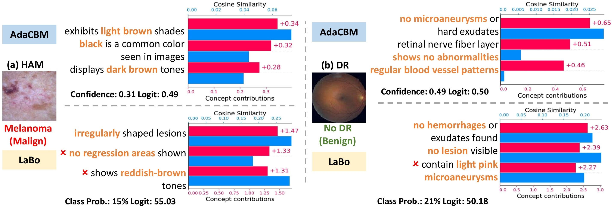

# AdaCBM: An Adaptive Concept Bottleneck Model for Explainable and Accurate Diagnosis

[AdaCBM: An Adaptive Concept Bottleneck Model for Explainable and Accurate Diagnosis, MICCAI 2024](https://dl.acm.org/doi/abs/10.1007/978-3-031-72117-5_4)

Created by Townim Faisal Chowdhury, Vu Minh Hieu Phan, Kewen Liao, Minh-Son To, Yutong Xie, Anton van den Hengel, Johan W. Verjans, and Zhibin Liao

## Introduction

This research addresses limitations in Label-Free Concept Bottleneck Models (CBM) for medical diagnosis by re-examining the CBM framework as a simple linear classification system. Our analysis shows that current fine-tuning modules mainly rescale and shift outcomes, underutilizing the system's learning capacity. We propose an adaptive module between CLIP and CBM to bridge the gap between source and downstream domains, improving performance in medical applications.


## Concepts

We generate the concepts using GPT-4 for each dataset. Our GPT-4 prompt generated concepts are available in the [gpt_concepts](./gpt_concepts/) folder.

## Setup

**Kaggle (GPU, recommended):** open `notebooks/kaggle_run.ipynb`; it clones this repo, installs
`requirements-kaggle.txt`, checks the setup, extracts features, trains, evaluates. Attach a HAM10000 image
dataset (any folder layout; images are located by filename). CLIP ViT-L/14 weights are downloaded by `clip`
(internet on) or read from `CLIP_WEIGHTS` (a dataset containing `ViT-L-14.pt`; SHA-256 is verified).

**Local (Windows):** install torch from pytorch.org, then `pip install -r requirements.txt`.

### Paths (no hardcoded locations)
Everything is resolved in [project_paths.py](project_paths.py); override with environment variables:
`HAM_IMAGE_ROOT`, `SPLIT_DIR`, `RESULTS_DIR`, `CLIP_WEIGHTS`, `CLIP_CACHE_DIR`, `HAM_METADATA`.
Defaults: Kaggle `/kaggle/working/results`, local `./results`.

```
results/
  features/ViT-L-14/{train,val,test}_feats.pt (+ .meta.json fingerprint)
  runs/<run_name>/{concept_source,concepts,checkpoints,logs,metrics,config_snapshot.py}
```

### Pipeline
```
python scripts/check_setup.py                 # splits, images, CLIP hash, label/lesion check
python scripts/extract_features.py            # train/val/test features, cached + verified
bash train.sh adacbm_ham10000 777             # AdaCBM baseline (selection on train, monitor = val)
python train_xadacbm.py --baseline-run adacbm_ham10000   # X-AdaCBM, train/val only
python -m pytest tests                        # equivalence + intervention consistency + cache tests
python evaluate_models.py --split test        # once, after model selection
```
Feature caches record the split fingerprint (image names + labels), CLIP weight hash and preprocessing;
a mismatch raises `StaleCacheError` instead of silently reusing old features.

### Data notes
* Splits: `datasets/HAM10000/splits/class2images_{train,val,test}.p` = 8,010 / 1,000 / 1,005 images (kept as is).
* HAM10000 has 10,015 images of ~7,470 lesions. If these splits were drawn per image, the same lesion can sit in
  both train and test and inflate accuracy. `scripts/check_setup.py` reports shared lesions when
  `HAM10000_metadata.csv` is attached.

## Running the models (original instructions)

[train.sh](train.sh) trains the baseline. The pre-trained checkpoint in [saved_models](./saved_models/) was trained
elsewhere; its concept-selection index is not shipped, so it cannot be evaluated faithfully here. Retrain the
baseline with the pipeline above.

## Acknowledgement
This project uses code from the following repository: [LaBo](https://github.com/YueYANG1996/LaBo/tree/main)

## Source

CLIP: https://github.com/openai/CLIP

## Citation

```bibtex
@inproceedings{adacbm,
	title        = {{AdaCBM}: An Adaptive Concept Bottleneck Model for Explainable and Accurate Diagnosis},
	author       = {Faisal Chowdhury, Townim and Liao, Kewen and Minh Hieu Phan, Vu and To, Minh-Son and Xie, Yutong and Hengel, Anton van den and W. Verjans, Johan and Liao, Zhibin},
	year         = 2024,
	booktitle    = {27th International Conference on Medical Image Computing and Computer Assisted Intervention (MICCAI)}
}
```